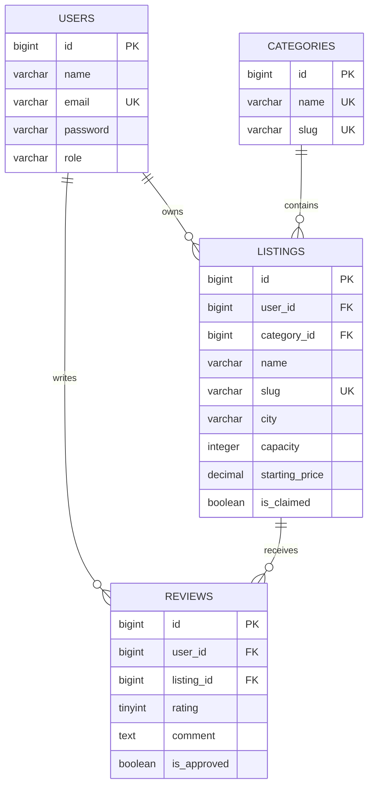

# Task 2 database schema

- Each venue listing belongs to a category and to an owner/user. Ownership is initial seeded attribution, **not proof of a verified claim**; that flow is a later task.
- Each review belongs to one user and one venue. The `(listing_id, user_id)` unique constraint permits at most one review per user per venue.
- Restrict deleting owners/categories while listings reference them; delete a listing's reviews when the listing is deleted.
- `reviews.rating` must be validated within 1–5 in Task 3; database uses unsigned tinyint and does not independently enforce the 1–5 upper bound.
- Illustrative venue names and addresses are fictitious demo data generated/seeded for development, not verified businesses.
